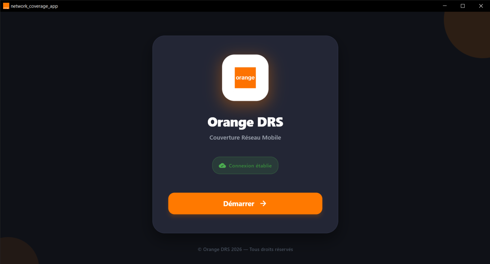
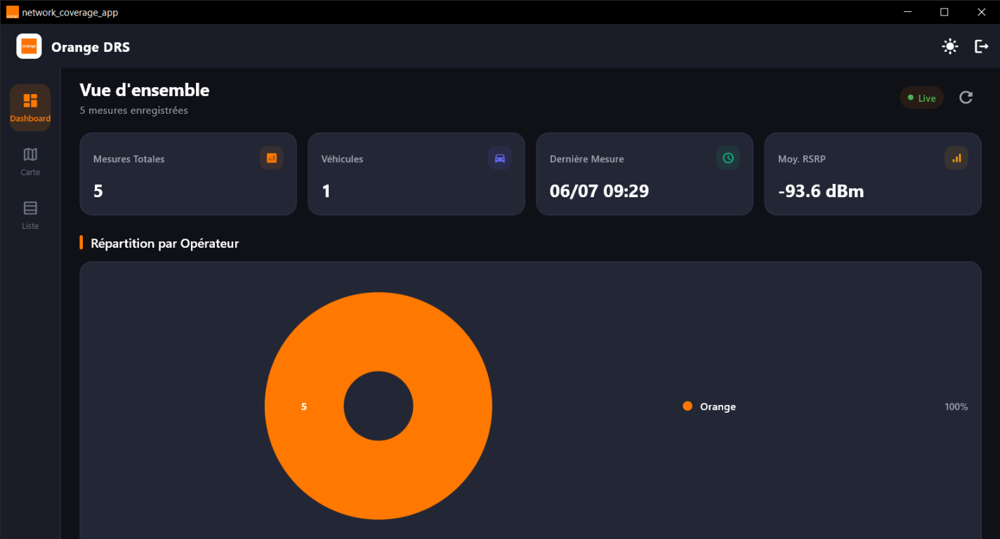
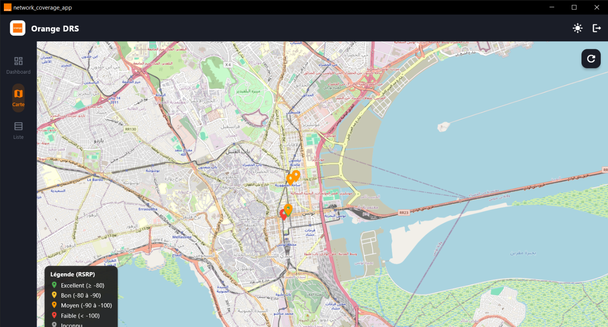
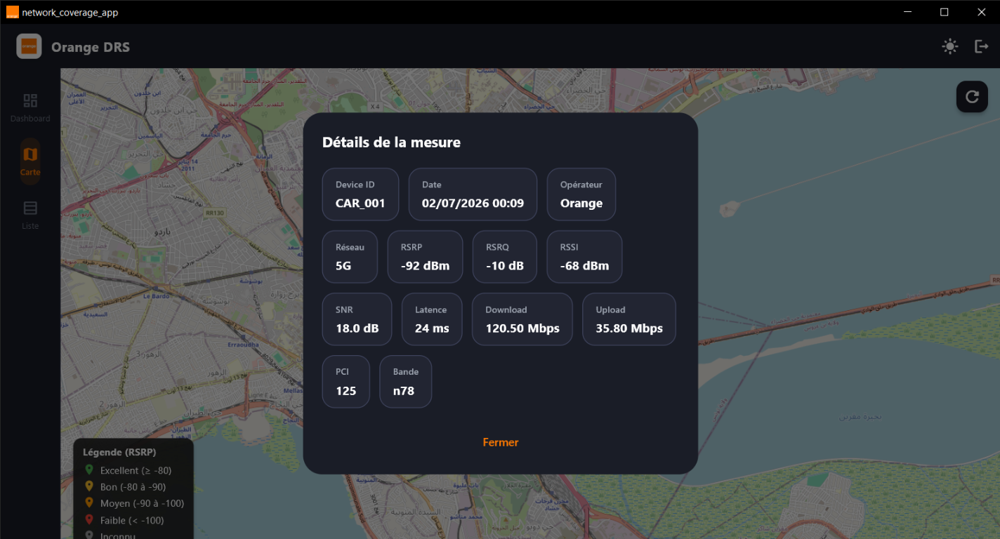
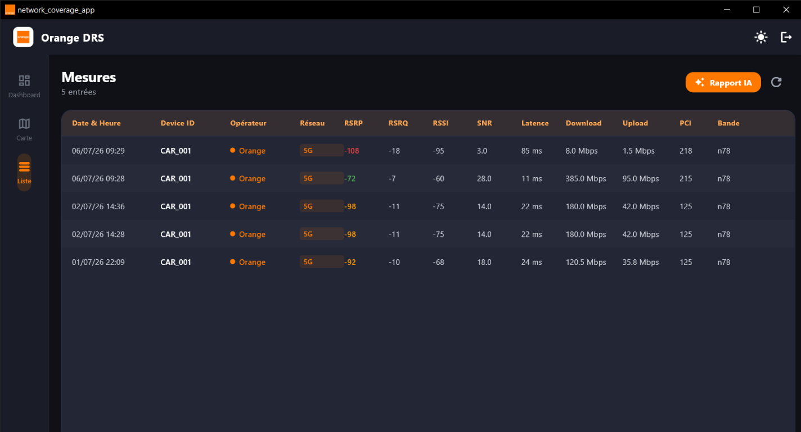
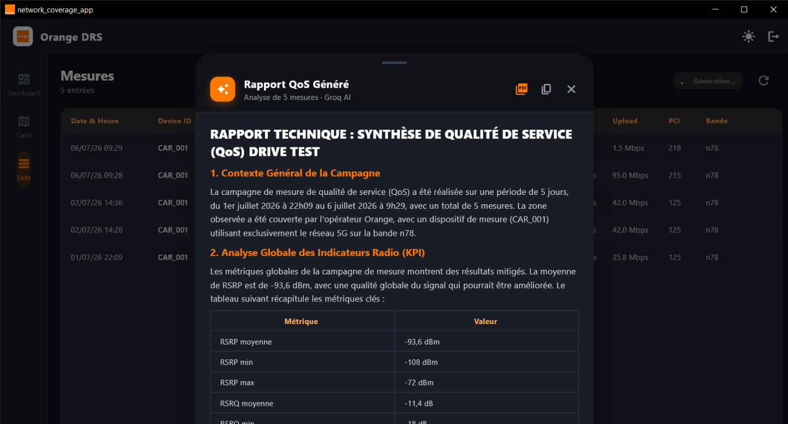
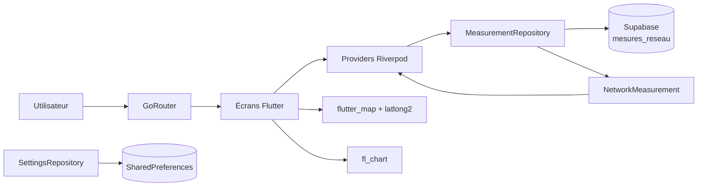

# Orange DRS — Couverture réseau mobile

Application desktop Flutter développée au sein d’Orange pour consulter et analyser des mesures de couverture et de qualité de service (QoS) du réseau mobile.

Le tableau de bord synthétise les mesures. Une carte permet de les situer, tandis que les vues Liste et Détails donnent accès aux relevés et à leurs indicateurs radio et réseau. L’application comprend également une interface de rapport QoS.

## Aperçu de l’application

### Accueil et connexion

Écran d’entrée de l’application et état de connexion.



### Tableau de bord

Vue d’ensemble des mesures enregistrées, des véhicules, du dernier relevé et du RSRP moyen, avec une répartition par opérateur.



### Carte de couverture

Carte des relevés géolocalisés avec une légende de qualité du signal selon le RSRP.



### Détails d’une mesure

Fenêtre de détail présentant l’opérateur, la technologie et les principaux indicateurs radio et QoS.



### Liste des mesures

Vue tabulaire des mesures, avec les paramètres radio, la latence, les débits, le PCI et la bande.



### Rapport QoS

Exemple de synthèse QoS générée à partir des mesures affichées.



## Fonctionnalités

- Tableau de bord avec indicateurs de synthèse et répartition par opérateur.
- Cartographie des mesures avec classification visuelle de la qualité du signal.
- Consultation des relevés sous forme de liste et de fiches détaillées.
- Filtrage des mesures par période, opérateur, technologie réseau et appareil.
- Affichage des métriques radio et QoS : RSSI, RSRP, RSRQ, SNR, latence, débits descendant et montant, PCI et bande.
- Réglages de l’application, dont le thème clair/sombre et la connexion aux données.
- Interface de rapport QoS.

## Architecture

L’application suit une architecture Flutter organisée en couches : les écrans présentent les données, Riverpod gère l’état et les filtres, puis les repositories assurent l’accès aux sources de données. Le modèle `NetworkMeasurement` convertit les relevés JSON en objets Dart typés.



Le repository des mesures interroge la table Supabase `mesures_reseau` par HTTP et actualise le flux toutes les 10 secondes. `GoRouter` gère les routes de connexion, d’accueil, de navigation principale et de paramètres. Les préférences locales sont conservées avec `SharedPreferences`.

## Technologies

- **Flutter / Dart** pour l’application desktop.
- **Riverpod** pour la gestion de l’état et des filtres.
- **GoRouter** pour la navigation.
- **Supabase** pour la lecture des mesures réseau.
- **flutter_map** et **latlong2** pour la cartographie.
- **fl_chart** pour les graphiques.
- **SharedPreferences** pour les préférences locales.

Le dépôt contient les cibles de plateforme Windows, Linux et macOS.

## Lancer l’application

Prérequis : Flutter installé et configuré pour la plateforme cible. Depuis la racine du dépôt :

```bash
flutter pub get
flutter run -d windows
```

Remplacez `windows` par `linux` ou `macos` selon votre plateforme.

### Connexion Supabase

La connexion peut être configurée dans l’application ou via les variables de compilation `SUPABASE_URL` et `SUPABASE_ANON_KEY`. Ne publiez pas de clés ou d’identifiants dans le dépôt.
